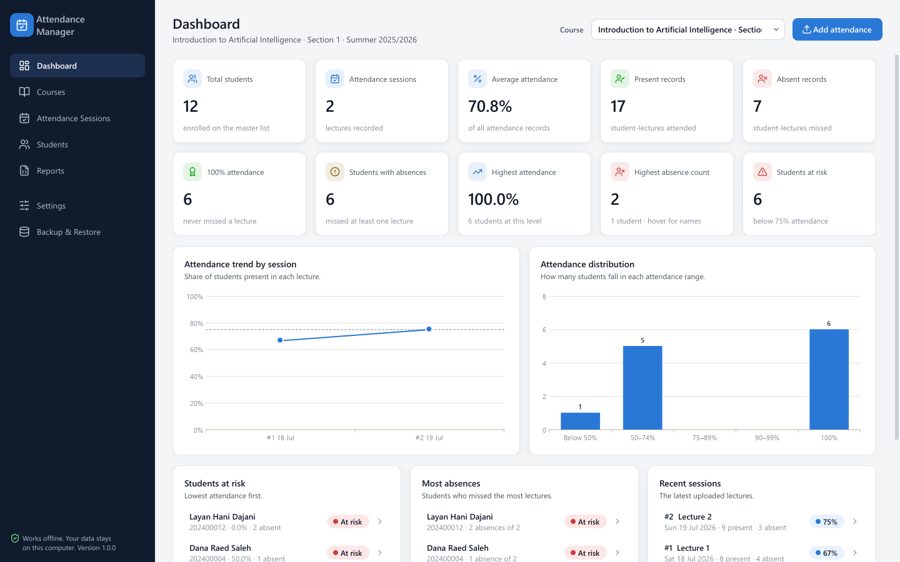
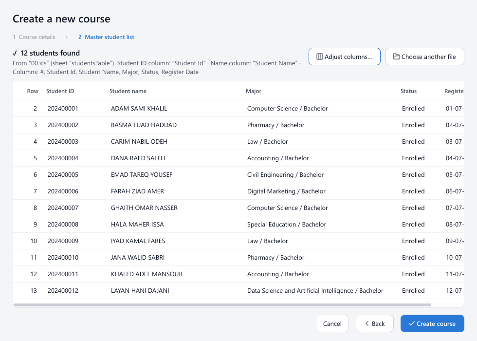
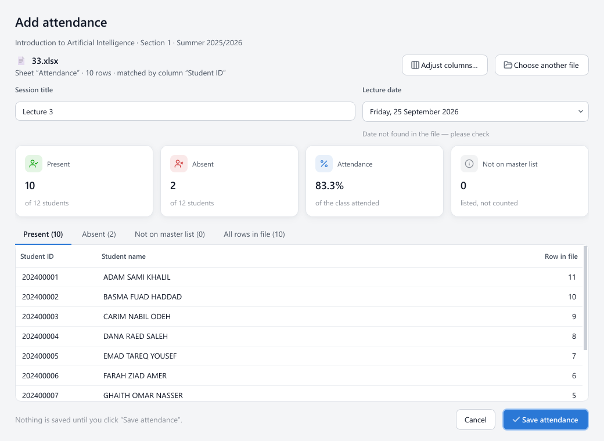
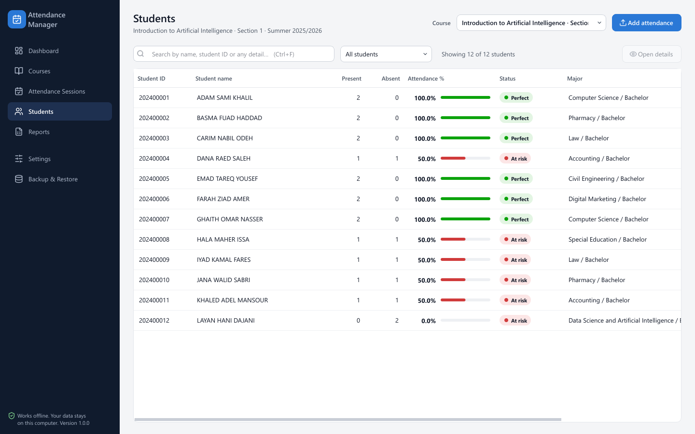
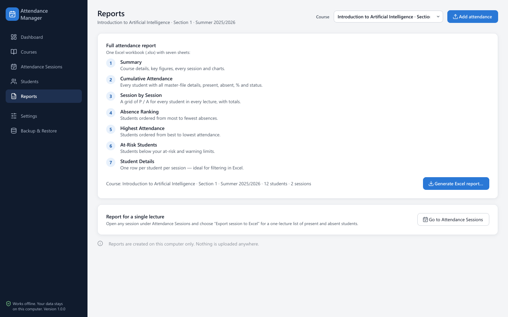

# Attendance Manager

**Offline attendance management for university instructors, built on the Excel files they already have.**

[](https://github.com/yousef-yasin/attendance-manager/actions/workflows/ci.yml)


-41CD52)


Attendance Manager is a Windows desktop application for university instructors and academic
staff. An instructor creates a course from the official master student list (for example
`00.xls`), then adds each lecture's attendance export (for example a Microsoft Teams attendance
report, `11.xls`, `22.xls`, …). The application matches every row to the roster **by student ID**,
records who was present and who was absent, and keeps a cumulative, auditable history for the
whole term: dashboards, at-risk lists and a complete Excel report, in English or Arabic.

Everything runs locally. No account, no server and no internet connection are required, and no
student data ever leaves the computer.



---

## Contents

- [Who it is for](#who-it-is-for)
- [Key features](#key-features)
- [How it works](#how-it-works)
- [Arabic and English](#arabic-and-english)
- [Privacy and data storage](#privacy-and-data-storage)
- [Architecture](#architecture)
- [Developer setup](#developer-setup)
- [Testing and quality gates](#testing-and-quality-gates)
- [Windows build, release and installation](#windows-build-release-and-installation)
- [Validation status](#validation-status)
- [Roadmap](#roadmap)
- [Documentation](#documentation)
- [License and status](#license-and-status)

---

## Who it is for

Instructors and academic staff who take attendance through online meetings or sign-in sheets and
receive the results as spreadsheets. Attendance Manager replaces the manual work of copying those
spreadsheets into a gradebook: it turns a folder of weekly exports into a per-student attendance
record that can be reviewed, explained to students and exported for the department.

## Key features

| Area | Capabilities |
|---|---|
| **Courses** | Multiple courses and sections with fully isolated rosters and attendance. Edit details, update the student list, archive/restore, or delete permanently (typed confirmation and an automatic backup first). |
| **Excel attendance workflow** | Import `.xls`, `.xlsx`, CSV/TSV (including UTF-16 Teams downloads) and HTML tables saved as `.xls`. The student ID and name columns are detected automatically, even when a file has no header row; a column-mapping screen appears whenever detection is not certain. |
| **Student ID matching** | Rows are matched by normalized student ID, never by row order or by name. E-mail/UPN identifiers, numeric cells, Excel text markers, stray whitespace and case differences are all handled. People who are not on the roster (organizers, guests) are listed but never counted. |
| **Cumulative attendance** | Each uploaded file becomes an immutable session. Present/absent counts and percentages accumulate across the term; students added to the roster later are only counted from the session after they joined. |
| **Dashboard and analytics** | Total students, sessions, average attendance, present/absent records, students with 100 % attendance, students with absences, highest absence count, attendance trend by session and attendance distribution charts. |
| **At-risk students** | Configurable *Warning* and *At risk* thresholds (default 85 % and 75 %), with ranked at-risk and most-absent lists on the dashboard and in the report. |
| **Excel reporting** | One-click `.xlsx` report with seven sheets: Summary (with charts), Cumulative Attendance, Session by Session, Absence Ranking, Highest Attendance, At-Risk Students and Student Details. Single sessions can be exported too. |
| **Session history** | Every upload keeps the original file (byte-for-byte), the processed result, lecture date, session number and counts. Sessions can be reviewed, renamed, or removed from statistics and restored later. |
| **Data safety** | SQLite with write-ahead logging, append-only attendance records enforced by database triggers, duplicate-upload detection, an audit log, automatic daily backups and validated manual backup/restore. |
| **Arabic and English** | Complete bilingual interface with a true right-to-left layout in Arabic, switchable at runtime and remembered across restarts. |

| Create course | Review attendance before saving |
|---|---|
|  |  |

| Students | Excel report |
|---|---|
|  |  |

*Screenshots use synthetic, fictional students.*

## How it works

1. **Create a course** and upload the master student list. The preview shows every student found
   and the columns that were recognized.
2. **Add attendance** after each lecture: choose (or drag in) the attendance export. The review
   screen shows present, absent and *not on master list* rows and the lecture date detected from
   the file. Nothing is saved until **Save attendance** is clicked.
3. **Follow the term** on the dashboard and the students page; every number updates immediately.
4. **Export** the full Excel report from *Reports*.

Matching rules, in short:

- a roster student whose ID appears anywhere in the file is **present**; every other roster
  student is **absent**;
- repeated rows (for example, re-joining a meeting) count once;
- rows that are not on the roster are shown separately and never create students;
- attendance % = present ÷ (present + absent) over active sessions only.

Uploading the same file twice is detected (also when renamed) and blocked unless explicitly
confirmed. The full algorithm, including how header-less and sorted Teams exports are parsed, is
described in [docs/ARCHITECTURE.md](docs/ARCHITECTURE.md).

## Arabic and English

- The interface is fully translated into Arabic and English. Every user-facing string comes from
  `locales/en.json` and `locales/ar.json`, and a test fails if any UI text is hard-coded.
- Arabic uses a genuine **right-to-left** layout: Qt mirrors the sidebar, tables, headers,
  dialogs and scroll bars.
- The language can be switched at any time from the top bar (**العربية | English**) or from
  *Settings*. The current page, course and filters are kept, and the choice persists across
  restarts.
- Arabic plural rules (all six CLDR forms), localized month and day names, and Western digits are
  used consistently. Course names, student names, IDs and file names are data and are never
  translated; left-to-right data inside Arabic sentences is isolated so it cannot be reordered.
- Excel reports follow the interface language; Arabic reports use right-to-left worksheets.

## Privacy and data storage

- **Offline by design.** The application makes no network connections.
- **Local storage.** Data lives in `%LOCALAPPDATA%\AttendanceManager\` (SQLite database, original
  uploads, backups and logs). The location can be overridden with the
  `ATTENDANCE_MANAGER_DATA_DIR` environment variable, for example for portable use.
- **Uninstalling keeps the data**, so upgrades and reinstalls never lose a course.
- **This repository contains no real student data.** Real attendance files, databases, reports and
  backups are excluded by `.gitignore`; tests and screenshots use synthetic fixtures.

See [SECURITY.md](SECURITY.md) for the data-handling model and how to report a vulnerability.

## Architecture

Python 3.10+, PySide6 (Qt 6) for the UI, SQLite for storage, `openpyxl`/`xlrd` for spreadsheets.
The code is layered so that business rules can be tested without a UI or a database:

```
src/attendance_manager/
├── domain/        pure business logic: ID normalization, matching, statistics, models
├── importing/     spreadsheet reading, table/ID/header detection, row parsing
├── persistence/   SQLite schema and migrations, repositories (the only place with SQL)
├── services/      use cases called by the UI (no Qt)
├── reporting/     Excel report writer
├── i18n/          catalog lookup, plurals, dates, bidirectional-text helpers
├── locales/       en.json, ar.json
└── ui/            PySide6 main window, pages, dialogs, widgets
```

Dependencies point inwards only (`ui → services → domain/importing/persistence/reporting`), the
UI never runs SQL and services never import Qt. The schema is versioned with ordered migrations
and already models multiple instructors and future synchronization. Details:
[docs/ARCHITECTURE.md](docs/ARCHITECTURE.md).

## Developer setup

Requirements: Windows 10/11 and Python 3.10 or newer.

```powershell
git clone https://github.com/yousef-yasin/attendance-manager.git
cd attendance-manager
python -m venv .venv
.venv\Scripts\python -m pip install -r requirements-dev.txt
.venv\Scripts\python -m pip install -e .
.venv\Scripts\python -m attendance_manager
```

`python -m attendance_manager --self-test` runs an end-to-end smoke test (import, matching, UI,
report and backup) in a temporary folder. See [CONTRIBUTING.md](CONTRIBUTING.md) for conventions.

## Testing and quality gates

```powershell
.venv\Scripts\python -m pytest       # 153 tests (UI tests run headless)
.venv\Scripts\ruff check .
.venv\Scripts\ruff format --check .
.venv\Scripts\mypy
```

The suite covers ID normalization, file detection (including header-less and sorted Teams
exports), matching, statistics, the full multi-week workflow, backup/restore, all report sheets,
every page and dialog, localization completeness, runtime language switching, RTL layout and
language persistence across real application restarts. Tests that need the instructor's real
files are skipped automatically when those files are absent (as in CI); synthetic fixtures
reproduce the same formats. All four gates run on every push and pull request
([.github/workflows/ci.yml](.github/workflows/ci.yml)).

## Windows build, release and installation

```bat
build.bat
```

The build creates an isolated environment, runs the tests, freezes the application with
PyInstaller, runs the frozen executable's self-test and compiles an Inno Setup installer:

**`dist\installer\Attendance Manager Setup.exe`**

The installer is per-user (no administrator rights), creates Start Menu and optional desktop
shortcuts, registers an uninstaller, upgrades in place and keeps user data on uninstall. Installed
computers need nothing else: Python and the build tools are bundled or not required. Installers
are published as **GitHub Release assets**, never committed to the repository.

Full procedure, signing and antivirus guidance: [docs/RELEASE.md](docs/RELEASE.md).

## Validation status

Version 1.0.0 was validated on Windows 11 (x64):

| Check | Result |
|---|---|
| Automated tests | 153 passed |
| `ruff check`, `ruff format --check`, `mypy` | clean |
| Frozen executable self-test | passed |
| Packaged and installed app: English ↔ Arabic, RTL ↔ LTR, persistence after restart | passed (UI automation of the real windowed app) |
| Real five-file workflow (master list + four Microsoft Teams exports, 45 students) through the GUI, checked against an independent calculation from the raw files, including the Excel report | passed |
| Clean install, launch without Python on `PATH`, data persistence, uninstall (files, shortcuts and registry entry removed; data kept) | passed |

Known caveat: release binaries are not yet code-signed. Windows SmartScreen may warn, and some
heuristic antivirus engines flag PyInstaller's launcher (see [docs/RELEASE.md](docs/RELEASE.md)).

## Roadmap

- Code-signed releases.
- Minimum-duration presence rules (for example, "attended at least 30 minutes"). The duration
  column is already stored with every session, so this needs no re-import.
- Dark theme.
- Optional cloud synchronization, multi-instructor accounts, automatic updates and licensing; the
  database schema already carries the identifiers and revision fields these need.

## Documentation

| Document | Contents |
|---|---|
| [docs/USER_GUIDE.md](docs/USER_GUIDE.md) | Installing and using the application, file formats, backups, troubleshooting |
| [docs/ARCHITECTURE.md](docs/ARCHITECTURE.md) | Layers, matching algorithm, database design, localization, backup format |
| [docs/RELEASE.md](docs/RELEASE.md) | Building, verifying, signing and publishing a release |
| [CONTRIBUTING.md](CONTRIBUTING.md) | Development workflow and conventions |
| [SECURITY.md](SECURITY.md) | Data handling and vulnerability reporting |
| [CHANGELOG.md](CHANGELOG.md) | Release history |

## License and status

Version **1.0.0**, production-ready for Windows 10/11 (x64).

This project is **proprietary** (see `pyproject.toml`). No open-source license is granted and all
rights are reserved by the owner. Please contact the repository owner before reusing or
redistributing the code.

Third-party components keep their own licenses: PySide6/Qt (LGPLv3), openpyxl (MIT),
xlrd (BSD), icons adapted from Lucide (ISC).
